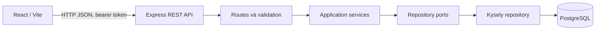

# LifeOS

Ứng dụng quản lý nhịp sống cá nhân, dự án và việc học. LifeOS giúp người dùng theo dõi mục tiêu, công việc, lịch học và thói quen trong một không gian thống nhất.

## 1. Thông tin học phần Tương tác người - máy

- **Học phần:** Tương tác người - máy
- **Mã lớp:** INT2041 1
- **Giảng viên:** Ngô Thị Duyên
- **Thành viên nhóm:**

| Họ và tên | MSSV |
|---|---|
| Trần Đình Hiếu | 23021555 |
| Hồ Văn Tiến Nguyên | 23021649 |
| Bùi Quang Huy | 23021571 |
| Nguyễn Mạnh Hoàng | 24021489 |
## 2. Giới thiệu dự án

LifeOS là ứng dụng web hỗ trợ người dùng tổ chức các khía cạnh thường ngày như kế hoạch dự án, nhiệm vụ và học tập. Trang Tổng quan tóm tắt tiến độ, còn các khu vực Dự án, Học tập và Cá nhân cung cấp công cụ quản lý chi tiết. Dữ liệu được lưu ở backend và gắn với tài khoản người dùng.

## 3. Chức năng chính

- **Tài khoản:** đăng ký, đăng nhập, xác thực phiên và đăng xuất.
- **Tổng quan:** xem tiến độ dự án, GPA, chuỗi ngày và bài tập đang chờ.
- **Dự án:** tab **Hạn task** hiển thị công việc từ tất cả dự án theo hạn nộp. Mỗi dự án có trang chi tiết trong cùng tab với các mục **Công việc**, **Tài liệu** và **Bấm giờ**. Có thể đặt hạn, ưu tiên và phụ thuộc giữa các task cùng dự án. Tệp đính kèm tối đa 10 MB mỗi tệp được gom từ các task. Đồng hồ lưu từng phiên làm việc theo task hoặc theo dự án.
- **Học tập:** mỗi môn mở trong cùng tab, với điểm, số buổi nghỉ, giờ học và tiến độ bài tập ngay dưới tên môn. Có thể mở lịch học, quản lý kỳ thi, ghi chú, tài liệu, phụ thuộc và bấm giờ từng bài tập. Mục **Bài tập** gom hạn nộp từ nhiều môn.
- **Lịch trình:** chuyển tuần, nhảy tới một ngày hoặc xem tổng quan 4 tuần. Lịch hiển thị buổi học, sự kiện cá nhân và hạn chót của việc cá nhân lẫn task dự án. Có thể đặt khung giờ rảnh, kéo thả hoặc nhờ LifeOS gợi ý và lưu phiên làm việc.
- **Công việc:** lịch **Việc làm** như đi dạy hay làm thêm tự lặp cùng thứ và giờ mỗi tuần kể từ ngày bắt đầu. **Việc cá nhân** như sinh nhật hoặc du lịch diễn ra một lần, có thể đặt giờ cụ thể hoặc đưa vào hàng đợi để xếp sau. Có thể đặt hạn chót và xem tiến độ việc dự án.
- **Trợ lý LifeOS:** tra cứu dữ liệu trong tài khoản và đề xuất tạo, sửa hoặc xóa các mục của LifeOS. Xem từng thay đổi, rồi chọn **Áp dụng** hoặc **Bỏ qua**.
- **Thời gian tự học:** bấm giờ, tạm dừng/tiếp tục, lưu study log và xem heatmap theo tuần.
- **Cá nhân:** cập nhật hồ sơ và đổi mật khẩu.
- **Trải nghiệm giao diện:** chuyển chế độ sáng/tối, hỗ trợ menu ở màn hình di động.

## 4. Công nghệ sử dụng

| Thành phần | Công nghệ |
|---|---|
| Frontend | React 19, TypeScript, Vite, CSS, Lucide React |
| Backend/API | Node.js, Express 5, TypeScript, Zod |
| Truy cập dữ liệu | Kysely |
| Cơ sở dữ liệu | PostgreSQL 17 |
| Kiểm thử tự động | Playwright Test, Chromium |
| Đóng gói/chạy dịch vụ | Docker Compose, Nginx |

Backend dùng bearer token cho phiên đăng nhập; mật khẩu được băm bằng scrypt và token phiên chỉ được lưu dưới dạng SHA-256 hash.

## 5. Kiến trúc

Frontend gọi REST API bằng JSON. API xử lý xác thực và kiểm tra dữ liệu ở route, chuyển quy tắc nghiệp vụ tới các service, rồi truy cập PostgreSQL qua repository và Kysely.



Migration database nằm trong `backend/src/database/migrations/`. Với Docker Compose, API chạy migration trước khi khởi động server.

## 6. Cấu trúc thư mục

```text
lifeOS-main/
├── backend/
│   └── src/
│       ├── application/       # Services, model và repository ports
│       ├── database/          # Kết nối, migration và seed dữ liệu demo
│       ├── infrastructure/   # Repository dùng Kysely
│       ├── middleware/        # Xác thực và xử lý lỗi
│       └── routes/            # Các REST API
├── frontend/
│   └── src/                   # React pages, API client, styles
├── test/
│   ├── lifeos.spec.ts         # Kiểm thử Playwright giao diện và API
│   └── KICH-BAN-KIEM-THU.md   # Kịch bản kiểm thử thủ công
├── docker-compose.yml
├── render.yaml
└── README.md
```

## 7. Cài đặt và chạy dự án

### Yêu cầu

- Node.js 22 trở lên và npm.
- Docker Desktop với Docker Compose.

### Chạy toàn bộ ứng dụng bằng Docker

Từ thư mục gốc dự án:

```powershell
docker compose up --build -d
```

- Frontend: <http://localhost:5173>
- API health check: <http://localhost:4000/health>
- PostgreSQL: `localhost:5432` (chỉ dùng cho phát triển cục bộ)

Kiểm tra dịch vụ:

```powershell
docker compose ps
```

### Chạy chế độ phát triển

Khởi động PostgreSQL:

```powershell
docker compose up -d db
```

Trong terminal backend:

```powershell
cd backend
Copy-Item .env.example .env
npm install
npm run db:migrate
npm run dev
```

Trong terminal frontend:

```powershell
cd frontend
Copy-Item .env.example .env
npm install
npm run dev
```

Frontend chạy ở `http://localhost:5173` và Vite proxy `/api` tới backend ở cổng `4000`.

### Deploy bản demo trên Render Free và Neon Free

Tạo project PostgreSQL trên Neon ở vùng Singapore và lấy chuỗi kết nối **Direct** có TLS từ mục **Connect**. Trong Render, tạo Blueprint từ nhánh GitHub có `render.yaml`, chọn gói Free và nhập chuỗi kết nối Neon vào biến `DATABASE_URL` của backend. Backend chạy migration trước khi khởi động. Frontend nhận URL của API từ Blueprint.

Nếu cập nhật một Blueprint đã có, đặt lại `DATABASE_URL` trong mục **Environment** của backend Render. Chuỗi này chứa thông tin đăng nhập DB, nên lưu trong cấu hình riêng của Render. Có thể đăng ký một tài khoản trên bản web để nhập dữ liệu demo.

Blueprint tạo `ASSISTANT_SETTINGS_KEY` cho backend để mã hóa các API key cá nhân. Trên bản web, đăng nhập rồi mở **Cài đặt → Trợ lý AI**, chọn **OpenAI**, nhập API key có hạn mức và lưu kết nối. Giữ giá trị `ASSISTANT_SETTINGS_KEY` khi cập nhật dịch vụ để backend tiếp tục mở được khóa đã lưu.

### Tài khoản demo

Sau khi migration database, có thể tạo dữ liệu demo:

```powershell
cd backend
npm run db:seed:demo
```

- Email: `uet-demo@lifeos.local`
- Mật khẩu: `UETLifeOS123!`

### Dùng Trợ lý LifeOS với API key

Đặt `ASSISTANT_SETTINGS_KEY` thành khóa ngẫu nhiên riêng của backend, chạy migration và khởi động lại API. Tạo khóa máy chủ bằng `node -e "console.log(require('node:crypto').randomBytes(32).toString('hex'))"` rồi lưu trong `backend/.env` hoặc trình quản lý secret của môi trường triển khai. Giữ cùng một giá trị qua các lần khởi động để mở được API key đã lưu.

Sau khi đăng nhập, vào **Cài đặt → Trợ lý AI** để lưu API key OpenAI, Google Gemini hoặc GroqCloud. GroqCloud mặc định dùng `qwen/qwen3.8-27b`, hỗ trợ chat, gọi công cụ LifeOS và đọc ảnh slide trong hạn mức của gói miễn phí. Với bản tự triển khai, nên dùng khóa thuộc tài khoản của người vận hành. `OPENAI_API_KEY` và `OPENAI_MODEL` vẫn có thể cấu hình kết nối mặc định trên backend.

**Trợ lý** ở thanh trên cùng mở chat chung, chat của môn học hoặc chat của dự án đang xem. Trợ lý dùng dịch vụ LifeOS theo tài khoản đang đăng nhập và đưa thao tác ra xem trước để duyệt. Đề xuất chờ duyệt tối đa 10 phút. Câu hỏi, dữ liệu công cụ và tệp được đính kèm để phân tích sẽ được gửi từ backend đến nhà cung cấp đang dùng. Có thể xóa lịch sử chat trong từng ngữ cảnh.

Đính kèm PDF, PNG hoặc JPG trong chat để phân tích, rồi bấm **Lưu vào Tài liệu** để lưu tệp vào môn hay dự án hiện tại. Khi dùng GroqCloud, chọn ảnh PNG hoặc JPG của trang cần đọc. Trong trang môn, mở **Đầu điểm → Lấy tỷ trọng từ slide** để duyệt tên, trọng số và trang nguồn trước khi đưa vào bảng điểm và bấm **Lưu điểm**.

## 8. Kiểm thử và kết quả

Bộ test Playwright nằm tại `test/lifeos.spec.ts` và `test/manual-scenarios.spec.ts`. Bộ test bao gồm kiểm thử giao diện, điều hướng mobile, API, giờ trống, phản hồi gợi ý và thời điểm hoàn thành công việc. Sau khi ứng dụng và PostgreSQL hoạt động, từ thư mục gốc chạy:

```powershell
npm.cmd install
$env:PLAYWRIGHT_BROWSERS_PATH = Join-Path $env:TEMP 'lifeos-playwright-browsers'
npm.cmd exec -- playwright test test/lifeos.spec.ts test/manual-scenarios.spec.ts --reporter=list
```

Nếu Chromium chưa được cài trong thư mục trên, cài bằng:

```powershell
npm.cmd exec -- playwright install chromium
```
