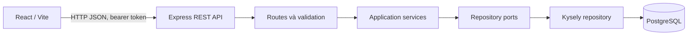

# LifeOS

Ứng dụng quản lý nhịp sống cá nhân, dự án và việc học. LifeOS giúp người dùng theo dõi mục tiêu, công việc, lịch học và thói quen trong một không gian thống nhất.

## 1. Thông tin học phần Tương tác người - máy

- **Học phần:** Tương tác người - máy
- **Mã lớp:** INT2041 1
- **Giảng viên:** Ngô Thị Duyên
- **Thành viên nhóm:**

| Họ và tên | MSSV |
|---|---|
| Trần Đình Hiếu | 23021555 |
| Hồ Văn Tiến Nguyên | 23021649 |
| Bùi Quang Huy | 23021571 |
| Nguyễn Mạnh Hoàng | 24021489 |
## 2. Giới thiệu dự án

LifeOS là ứng dụng web hỗ trợ người dùng tổ chức các khía cạnh thường ngày như kế hoạch dự án, nhiệm vụ và học tập. Trang Tổng quan tóm tắt tiến độ, còn các khu vực Dự án, Học tập và Cá nhân cung cấp công cụ quản lý chi tiết. Dữ liệu được lưu ở backend và gắn với tài khoản người dùng.

## 3. Chức năng chính

- **Tài khoản:** đăng ký, đăng nhập, xác thực phiên và đăng xuất.
- **Tổng quan:** xem số liệu dự án, tiến độ học tập, chuỗi ngày, hạt giống và bài tập đang chờ.
- **Dự án và task:** tạo, sửa, xóa dự án/task; cập nhật trạng thái, hạn và mức ưu tiên; tìm kiếm dự án/task; bật hoặc tắt nhắc hạn.
- **Học tập:** quản lý môn học, buổi học trong tuần, thời khóa biểu và bài tập; theo dõi tiến độ và thời hạn.
- **Thời gian tự học:** bấm giờ, tạm dừng/tiếp tục, lưu study log và xem heatmap theo tuần.
- **Cá nhân:** cập nhật hồ sơ, xem chuỗi ngày/XP/hạt giống và sử dụng hạt giống.
- **Trải nghiệm giao diện:** chuyển chế độ sáng/tối, hỗ trợ menu ở màn hình di động.

## 4. Công nghệ sử dụng

| Thành phần | Công nghệ |
|---|---|
| Frontend | React 19, TypeScript, Vite, CSS, Lucide React |
| Backend/API | Node.js, Express 5, TypeScript, Zod |
| Truy cập dữ liệu | Kysely |
| Cơ sở dữ liệu | PostgreSQL 17 |
| Kiểm thử tự động | Playwright Test, Chromium |
| Đóng gói/chạy dịch vụ | Docker Compose, Nginx |

Backend dùng bearer token cho phiên đăng nhập; mật khẩu được băm bằng scrypt và token phiên chỉ được lưu dưới dạng SHA-256 hash.

## 5. Kiến trúc

Frontend gọi REST API bằng JSON. API xử lý xác thực và kiểm tra dữ liệu ở route, chuyển quy tắc nghiệp vụ tới các service, rồi truy cập PostgreSQL qua repository và Kysely.



Migration database nằm trong `backend/src/database/migrations/`. Với Docker Compose, API chạy migration trước khi khởi động server.

## 6. Cấu trúc thư mục

```text
lifeOS-main/
├── backend/
│   └── src/
│       ├── application/       # Services, model và repository ports
│       ├── database/          # Kết nối, migration và seed dữ liệu demo
│       ├── infrastructure/   # Repository dùng Kysely
│       ├── middleware/        # Xác thực và xử lý lỗi
│       └── routes/            # Các REST API
├── frontend/
│   └── src/                   # React pages, API client, styles
├── test/
│   ├── lifeos.spec.ts         # Kiểm thử Playwright giao diện và API
│   └── KICH-BAN-KIEM-THU.md   # Kịch bản kiểm thử thủ công
├── docker-compose.yml
├── render.yaml
└── README.md
```

## 7. Cài đặt và chạy dự án

### Yêu cầu

- Node.js 22 trở lên và npm.
- Docker Desktop với Docker Compose.

### Chạy toàn bộ ứng dụng bằng Docker

Từ thư mục gốc dự án:

```powershell
docker compose up --build -d
```

- Frontend: <http://localhost:5173>
- API health check: <http://localhost:4000/health>
- PostgreSQL: `localhost:5432` (chỉ dùng cho phát triển cục bộ)

Kiểm tra dịch vụ:

```powershell
docker compose ps
```

### Chạy chế độ phát triển

Khởi động PostgreSQL:

```powershell
docker compose up -d db
```

Trong terminal backend:

```powershell
cd backend
Copy-Item .env.example .env
npm install
npm run db:migrate
npm run dev
```

Trong terminal frontend:

```powershell
cd frontend
Copy-Item .env.example .env
npm install
npm run dev
```

Frontend chạy ở `http://localhost:5173` và Vite proxy `/api` tới backend ở cổng `4000`.

### Tài khoản demo

Sau khi migration database, có thể tạo dữ liệu demo:

```powershell
cd backend
npm run db:seed:demo
```

- Email: `demo@lifeos.local`
- Mật khẩu: `LifeOS123!`

## 8. Kiểm thử và kết quả

Bộ test Playwright nằm tại `test/lifeos.spec.ts`, gồm các test giao diện riêng theo chức năng và test API. Sau khi ứng dụng và PostgreSQL hoạt động, từ thư mục gốc chạy:

```powershell
npm.cmd install
$env:PLAYWRIGHT_BROWSERS_PATH = Join-Path $env:TEMP 'lifeos-playwright-browsers'
npm.cmd exec -- playwright test test/lifeos.spec.ts --reporter=list
```

Nếu Chromium chưa được cài trong thư mục trên, cài bằng:

```powershell
npm.cmd exec -- playwright install chromium
```

**Kết quả chạy gần nhất: 11/11 test Passed.**

| # | Nhóm | Nội dung kiểm thử | Kết quả gần nhất |
|---:|---|---|---|
| 1 | Chức năng | Đăng nhập lại và đăng xuất | Passed |
| 2 | Chức năng | Hiển thị Tổng quan và lưu giao diện tối sau khi tải lại | Passed |
| 3 | Chức năng | Tạo, sửa, hoàn thành, tìm kiếm và xóa dự án cùng task | Passed |
| 4 | Chức năng | Bật/tắt nhắc hạn task | Passed |
| 5 | Chức năng | Thêm môn và lịch học, sửa/xóa buổi học, xem thời khóa biểu | Passed |
| 6 | Chức năng | Tạo, sửa, hoàn tất/khôi phục và xóa bài tập | Passed |
| 7 | Chức năng | Bấm giờ tự học, tạm dừng/tiếp tục và lưu study log | Passed |
| 8 | Chức năng | Sửa hồ sơ, chi hạt giống và điều hướng trên mobile | Passed |
| 9 | API | Health, đăng ký, đăng nhập sai, xác thực và thu hồi phiên | Passed |
| 10 | API | CRUD dự án/task, validation và ngăn truy cập chéo tài khoản | Passed |
| 11 | API | CRUD tài nguyên học tập, quyền môn học, hồ sơ và trạng thái cá nhân | Passed |

Trạng thái này phản ánh lần chạy Playwright gần nhất trong môi trường phát triển; chạy lại lệnh phía trên để cập nhật kết quả.
